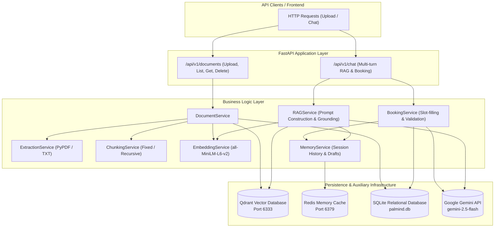

# PalmMind AI – Document-Based Conversational RAG & Interview Booking System

[](https://www.python.org/)
[](https://fastapi.tiangolo.com/)
[](https://qdrant.tech/)
[](https://redis.io/)
[](https://www.sqlite.org/)
[]()

An enterprise-grade, modular Python backend providing document ingestion, custom retrieval-augmented generation (RAG), session-isolated Redis conversational memory, and LLM-driven structured interview booking.

---

## 📌 Problem Statement

Modern enterprise HR and technical recruitment workflows demand seamless knowledge discovery combined with efficient candidate scheduling. Candidates often have queries regarding corporate policies, compensation structures, or technical requirements embedded within lengthy PDF manuals or text documentation. Simultaneously, scheduling initial technical interview slots requires multi-turn conversational interaction, slot-filling, and deterministic validation.

This backend application solves both challenges in a unified, production-oriented architecture:
1. **Document Ingestion & Indexing**: Ingests unstructured documentation (PDF and TXT), applies selectable chunking strategies (Fixed-size sliding window vs. Recursive character splitting), generates dense 384-dimensional embeddings via Sentence Transformers (`all-MiniLM-L6-v2`), indexes vector embeddings with rich metadata payloads in **Qdrant**, and persists relational metadata in **SQLite**.
2. **Custom Conversational RAG & Interview Booking**: A unified conversational interface powered by **Google Gemini** and **Redis session memory** that answers domain inquiries with strict source citations without hallucinating, while seamlessly recognizing interview scheduling intent to collect candidate details (full name, email, preferred date, and time slot) with deterministic validation and atomic database persistence.

---

## ✨ Key Features

- **Document Ingestion API (`POST /api/v1/documents/upload`)**:
  - Supports multi-format ingestion for `.pdf` and `.txt`.
  - Two selectable chunking strategies: **Fixed-size** (with configurable window size and overlap) and **Recursive Character Chunking** (hierarchical splitting by paragraph, newline, sentence, and word boundaries).
  - Dense vector embedding generation using local `all-MiniLM-L6-v2` (384 dimensions).
  - Vector storage in **Qdrant** with payload metadata (filename, chunk index, character bounds, document ID).
  - Transactional persistence in **SQLite** via SQLAlchemy 2.0 with automatic rollback compensation on vector/database discrepancies.
- **Custom Conversational RAG (No `RetrievalQAChain`, No `FAISS`, No `Chroma`)**:
  - Fully transparent, custom-orchestrated retrieval pipeline.
  - Cosine similarity thresholding to filter low-relevance noise.
  - Strict grounding prompt: instructs Gemini to rely solely on retrieved document chunks and explicitly decline answering if context is insufficient.
  - Returns structured source metadata citations (`document_id`, `filename`, `chunk_index`, `score`, and text snippet).
- **Persistent Redis-Based Multi-Turn Memory**:
  - Session-isolated conversational history identified by `session_id`.
  - Chronological message lists (`RPUSH` / `LRANGE`) storing role, content, and ISO UTC timestamps.
  - Sliding-window message pruning (`LTRIM`) and automated TTL session expiration.
  - Contextual query reformulation fallback for multi-turn follow-up questions (e.g. referential pronouns).
- **Conversational Interview Booking**:
  - LLM-powered structured extraction using Gemini JSON mode.
  - Step-by-step slot-filling (Name $\rightarrow$ Email $\rightarrow$ Date $\rightarrow$ Time) asking for one missing field at a time.
  - Deterministic Python validation: strict email validation, multi-format date parsing (`YYYY-MM-DD`, `DD Month YYYY`, `DD/MM/YYYY`), past date rejection against the baseline reference date, and 12h/24h time parsing.
  - Flexible conversational state handling: gracefully handles user corrections (e.g. changing previously provided dates).
  - Duplicate booking prevention in SQLite.
  - Atomic database commitment before issuing user confirmation.

---

## 🏗️ System Architecture

### Architectural Diagram



---

## 📂 Project Structure

```
palmind-rag-interview-assistant/
├── app/
│   ├── main.py                     # FastAPI application lifespan, CORS, & routing
│   ├── core/
│   │   ├── config.py               # Pydantic v2 BaseSettings configuration
│   │   └── logging.py              # Structured, colored logging configuration
│   ├── api/
│   │   ├── routes/
│   │   │   ├── documents.py        # Document upload, detail, list, and delete endpoints
│   │   │   └── chat.py             # Unified conversational RAG & booking chat routes
│   │   └── schemas/
│   │       ├── document.py         # Ingestion schemas (Strategy enum, Upload response)
│   │       ├── chat.py             # ChatRequest, ChatResponse, SourceChunk schemas
│   │       └── booking.py          # BookingDraft, BookingValidated, BookingResponse schemas
│   ├── services/
│   │   ├── extraction_service.py   # PDF (pypdf) & TXT encoding-aware extraction
│   │   ├── chunking_service.py     # Fixed-size and Recursive chunking strategies
│   │   ├── embedding_service.py    # Local SentenceTransformer embeddings (384-d)
│   │   ├── vector_service.py       # Qdrant client, collection setup, search, delete
│   │   ├── memory_service.py       # Redis session-isolated memory & draft storage
│   │   ├── rag_service.py          # Custom prompt construction, grounding, retrieval
│   │   ├── booking_service.py      # LLM slot-filling, deterministic validation, booking
│   │   └── document_service.py     # Orchestrator for transactional document ingestion
│   ├── repositories/
│   │   ├── document_repository.py  # SQLite repository for Document records
│   │   ├── chunk_repository.py     # SQLite repository for Chunk records
│   │   └── booking_repository.py   # SQLite repository for Booking records & duplicate check
│   ├── models/
│   │   ├── document.py             # SQLAlchemy Document ORM model
│   │   ├── chunk.py                # SQLAlchemy Chunk ORM model
│   │   └── booking.py              # SQLAlchemy Booking ORM model
│   ├── database/
│   │   ├── connection.py           # SQLAlchemy Engine, SessionLocal, and get_db dependency
│   │   └── init_db.py              # Schema initialization helper
│   └── utils/
│       ├── exceptions.py           # Central application exception hierarchy
│       └── validators.py           # Deterministic Python validators (File, Name, Email, Date, Time)
├── tests/
│   ├── test_health.py              # Health check and environment verification tests
│   ├── test_chunking.py            # Unit tests for Fixed & Recursive chunking strategies
│   ├── test_documents.py           # Unit and integration tests for document ingestion API
│   ├── test_vector.py              # Unit tests for embedding dimensions and Qdrant integration
│   ├── test_chat.py                # Custom RAG, Gemini grounding, and Redis memory tests
│   └── test_booking.py             # Interview booking slot-filling, validation, and SQLite tests
├── .env.example                    # Sanitized environment variable template
├── .gitignore                      # Git exclusion rules (secrets, venv, db, caches)
├── docker-compose.yml              # Local infrastructure (Qdrant & Redis services)
├── Dockerfile                      # Production container image definition
├── pytest.ini                      # Pytest async and warning filters
├── requirements.txt                # Pinned production and testing dependencies
└── README.md                       # Comprehensive system documentation
```

---

## 🛠️ Technology Stack

| Layer / Concern | Technology | Justification & Role |
|---|---|---|
| **Web Framework** | FastAPI 0.115+ | High performance, native OpenAPI documentation, async support |
| **Data Validation** | Pydantic v2 / Settings | Strict type enforcement, input normalization, environment management |
| **ASGI Server** | Uvicorn | High-throughput asynchronous server |
| **Vector Database** | Qdrant | Fast HNSW indexing, rich metadata payload filtering, REST & gRPC APIs |
| **Embeddings** | Sentence Transformers | Local `all-MiniLM-L6-v2` generating 384-dimensional dense vectors |
| **Conversational Memory** | Redis 5.0+ | Fast session-isolated list memory, TTL expiration, draft caching |
| **Relational Database** | SQLite + SQLAlchemy 2.0 | Transactional persistence for document metadata, chunks, and bookings |
| **LLM Provider** | Google Gemini API (`gemini-2.5-flash`) | Context grounding, reasoning, and structured JSON output |
| **PDF Extraction** | PyPDF 5.0+ | Pure-Python PDF parsing with corrupted stream and encryption protection |
| **Testing** | pytest + HTTPX + fakeredis | Comprehensive asynchronous and synchronous automated testing |
| **Containerization** | Docker + Docker Compose | One-command orchestration for external services (Qdrant and Redis) |

---

## ⚙️ Environment Variables

The application reads configuration from environment variables or a local `.env` file via `pydantic-settings`:

| Variable | Type | Default | Description |
|---|---|---|---|
| `PROJECT_NAME` | `str` | `PalmMind AI - Document RAG...` | Application name for OpenAPI docs |
| `ENVIRONMENT` | `str` | `development` | Runtime environment (`development`, `production`) |
| `DEBUG` | `bool` | `True` | Debug mode toggle |
| `API_V1_PREFIX` | `str` | `/api/v1` | Root routing prefix for v1 endpoints |
| `HOST` | `str` | `0.0.0.0` | Binding host address |
| `PORT` | `int` | `8000` | Application port |
| `LOG_LEVEL` | `str` | `INFO` | Logging verbosity (`DEBUG`, `INFO`, `WARNING`, `ERROR`) |
| `GEMINI_API_KEY` | `str` | `""` | Google Gemini API key (**required for live LLM operations**) |
| `GEMINI_MODEL` | `str` | `gemini-2.5-flash` | Gemini model identifier |
| `EMBEDDING_MODEL_NAME`| `str` | `all-MiniLM-L6-v2` | SentenceTransformer model identifier |
| `EMBEDDING_DIMENSION` | `int` | `384` | Embedding dimensionality |
| `QDRANT_HOST` | `str` | `localhost` | Qdrant host |
| `QDRANT_PORT` | `int` | `6333` | Qdrant REST port |
| `QDRANT_COLLECTION` | `str` | `palmind_docs` | Vector collection name |
| `REDIS_HOST` | `str` | `localhost` | Redis host |
| `REDIS_PORT` | `int` | `6379` | Redis port |
| `REDIS_DB` | `int` | `0` | Redis database index |
| `REDIS_SESSION_TTL_SECONDS` | `int` | `86400` | Session memory expiration in seconds (24h) |
| `REDIS_HISTORY_LIMIT` | `int` | `10` | Maximum past interaction turns retrieved for context |
| `DATABASE_URL` | `str` | `sqlite:///./palmind.db` | SQLAlchemy database connection string |
| `MAX_UPLOAD_SIZE_MB` | `int` | `10` | Maximum file upload size in megabytes |
| `DEFAULT_FIXED_CHUNK_SIZE` | `int` | `500` | Default fixed chunk character size |
| `DEFAULT_FIXED_CHUNK_OVERLAP` | `int` | `50` | Default fixed chunk character overlap |
| `DEFAULT_RECURSIVE_CHUNK_SIZE` | `int` | `500` | Default recursive chunk character size |
| `DEFAULT_RECURSIVE_CHUNK_OVERLAP` | `int` | `50` | Default recursive chunk character overlap |

---

## 🚀 Quickstart & Setup Guide

### 1. Prerequisites
- **Python**: 3.11+
- **Docker & Docker Compose** (for running Qdrant and Redis)
- **Git**

### 2. Clone the Repository & Configure Environment
```bash
git clone https://github.com/Govinda-Yadav/palmind-rag-interview-assistant.git
cd palmind-rag-interview-assistant

# Copy environment template
cp .env.example .env
```
Edit `.env` to configure your `GEMINI_API_KEY`:
```ini
GEMINI_API_KEY="AIzaSy..."
```

### 3. Start Auxiliary Infrastructure (Qdrant & Redis)
Launch the vector database and Redis cache services using Docker Compose:
```bash
docker compose up -d
```
Verify running services:
- **Qdrant Dashboard**: [http://localhost:6333/dashboard](http://localhost:6333/dashboard)
- **Redis Server**: `localhost:6379`

> *Note: If Docker is unavailable, the application gracefully initializes a local persistent Qdrant store at `./qdrant_storage` and falls back to an embedded `fakeredis` engine, enabling fully functional offline testing without errors.*

### 4. Create Virtual Environment & Install Dependencies
```bash
python -m venv .venv

# Activate on Windows PowerShell:
.\.venv\Scripts\Activate.ps1
# Activate on Linux / macOS:
source .venv/bin/activate

# Install dependencies:
pip install -r requirements.txt
```

### 5. Launch the Application
```bash
uvicorn app.main:app --host 0.0.0.0 --port 8000 --reload
```

Interactive documentation:
- **Swagger UI**: [http://localhost:8000/docs](http://localhost:8000/docs)
- **ReDoc**: [http://localhost:8000/redoc](http://localhost:8000/redoc)
- **Health Check**: [http://localhost:8000/health](http://localhost:8000/health)

---

## 📖 API Documentation & Usage

### 1. Document Ingestion API

#### `POST /api/v1/documents/upload`
Uploads and indexes a PDF or TXT document using the chosen chunking strategy.

**Parameters (Multipart Form-Data):**
- `file`: Uploaded file (`.pdf` or `.txt`, max 10MB).
- `chunking_strategy`: `fixed` or `recursive` (default: `recursive`).
- `chunk_size`: Optional integer character chunk size (default: 500).
- `chunk_overlap`: Optional integer character overlap (default: 50).

**cURL Example (Recursive Strategy):**
```bash
curl -X POST "http://localhost:8000/api/v1/documents/upload" \
  -F "file=@company_policy.pdf;type=application/pdf" \
  -F "chunking_strategy=recursive"
```

**cURL Example (Fixed-size Strategy):**
```bash
curl -X POST "http://localhost:8000/api/v1/documents/upload" \
  -F "file=@engineering_handbook.txt;type=text/plain" \
  -F "chunking_strategy=fixed" \
  -F "chunk_size=300" \
  -F "chunk_overlap=30"
```

**Response (`201 Created`):**
```json
{
  "success": true,
  "document_id": 1,
  "filename": "company_policy.pdf",
  "extracted_character_count": 4820,
  "number_of_chunks": 11,
  "selected_chunking_strategy": "recursive",
  "number_of_embeddings_stored": 11,
  "message": "Document uploaded, chunked, embedded, and indexed successfully."
}
```

#### Additional Document Endpoints:
- `GET /api/v1/documents/`: List all ingested documents with metadata.
- `GET /api/v1/documents/{document_id}`: Retrieve detailed document info and chunk breakdown.
- `DELETE /api/v1/documents/{document_id}`: Atomically remove document and chunks from SQLite and purge vector points from Qdrant.

---

### 2. Conversational RAG & Interview Booking API

#### `POST /api/v1/chat`
A unified endpoint that handles both custom document RAG queries and multi-turn conversational interview booking.

**Request Payload:**
```json
{
  "session_id": "candidate_session_101",
  "message": "What is the company leave policy?"
}
```

#### Document Question Answering (Custom RAG)
Retrieves the most semantically relevant chunks from Qdrant, includes past turns from Redis memory, and prompts Gemini for a grounded answer.

**Response (`200 OK`):**
```json
{
  "session_id": "candidate_session_101",
  "response": "According to the company policy document, employees receive 20 days of paid annual leave per calendar year. Unused leave of up to 5 days may carry over to the subsequent year.",
  "sources_used": [
    {
      "document_id": 1,
      "filename": "company_policy.pdf",
      "chunk_index": 2,
      "score": 0.8841,
      "text_snippet": "All full-time engineering employees are entitled to 20 days of paid annual leave per calendar year. Unused leave up to 5 days may carry over..."
    }
  ],
  "intent": "document_rag",
  "action_info": null
}
```

#### Handling Insufficient Context
When no indexed document contains relevant information, the assistant explicitly declines to answer:
```json
{
  "session_id": "candidate_session_101",
  "response": "Based on the indexed documents, I could not find information regarding your inquiry. Please verify that the relevant document has been uploaded or rephrase your question.",
  "sources_used": [],
  "intent": "document_rag",
  "action_info": null
}
```

---

### 3. Conversational Interview Booking Walkthrough

The conversational interview booking system slot-fills 4 required fields (`name`, `email`, `interview_date`, and `interview_time`) one at a time, keeping partial state in Redis and persisting to SQLite only upon completion.

```
Turn 1:
User:      "I want to schedule an interview."
Assistant: "Sure! May I know your full name?"

Turn 2:
User:      "Govinda Yadav."
Assistant: "What is your email address?"

Turn 3:
User:      "govinda@example.com."
Assistant: "Which date would you prefer?"

Turn 4:
User:      "20 November 2026."
Assistant: "What time would you prefer?"

Turn 5:
User:      "10:30 AM."
Assistant: "Your interview booking request has been recorded successfully."
```

**Final Response Payload (`200 OK`):**
```json
{
  "session_id": "candidate_session_101",
  "response": "Your interview booking request has been recorded successfully.",
  "sources_used": [],
  "intent": "interview_booking",
  "action_info": {
    "booking_id": 1,
    "name": "Govinda Yadav",
    "email": "govinda@example.com",
    "interview_date": "2026-11-20",
    "interview_time": "10:30",
    "status": "confirmed"
  }
}
```

#### Validation & Robustness Highlights:
- **Email Validation**: Rejects invalid emails (e.g. `invalid_email`) and re-prompts without losing previously collected slots.
- **Date Validation**: Parses multiple natural date formats (`2026-11-20`, `20 November 2026`, `20/11/2026`). Automatically rejects past dates against the server reference date.
- **Time Validation**: Normalizes both 12-hour (`10:30 AM`, `2 PM`) and 24-hour (`14:30`) times into standard `HH:MM`.
- **Field Change Handling**: If the user provides a new date midway (e.g. *"Actually, change the date to 25 November 2026"*), the system updates the draft without re-asking name or email.
- **Duplicate Prevention**: Re-submitting an identical booking returns an informative message indicating the request is already recorded, preventing duplicate SQLite rows.
- **Disclaimer**: Accurately informs the candidate that the booking request has been recorded, rather than falsely claiming a live HR calendar slot is booked.

---

## 🧪 Testing & Verification

The test suite covers unit tests, API integration tests, chunking algorithms, vector embeddings, Redis memory isolation, and interview booking workflows.

### Run All Tests
```bash
pytest
```

### Verbose Test Execution
```bash
pytest -v
```

### Test Suite Summary
```
============================= 88 passed in 46.66s =============================
- tests/test_health.py:       3 passed  (Health checks, settings loading)
- tests/test_chunking.py:    10 passed  (Fixed & Recursive strategies, separators)
- tests/test_documents.py:   21 passed  (Extraction, PDF/TXT upload, rollback)
- tests/test_vector.py:      10 passed  (Embeddings, Qdrant vectors, payloads)
- tests/test_chat.py:        21 passed  (RAG grounding, citations, Redis memory)
- tests/test_booking.py:     23 passed  (Validators, 5-turn booking, scenarios A-I)
```

---

## 📐 Technical Decisions & Limitations

1. **Strictly Custom RAG Architecture**:
   - `RetrievalQAChain`, `FAISS`, and `Chroma` were explicitly prohibited and are **not used**. Retrieval is orchestrated directly against Qdrant, prompts are formatted manually, and generation uses the Google GenAI SDK with temperature 0.2 for strict factual grounding.
2. **Local Embedding Generation**:
   - Uses `all-MiniLM-L6-v2` locally via Sentence Transformers. This ensures embeddings are fast, free of external API rate limits, and run entirely within the backend environment.
3. **Resilient Offline Architecture**:
   - `VectorService` connects to Qdrant via REST/gRPC, with an automatic fallback to local persistent disk storage (`./qdrant_storage`) if the external container is unavailable.
   - `MemoryService` performs a non-blocking TCP socket probe to `localhost:6379` on startup. If Redis is unreachable, it seamlessly falls back to `fakeredis`, guaranteeing unit tests and CI runs never hang on network timeouts.
4. **Timezone Assumption**:
   - Dates and times are evaluated against server local / UTC time. In a production enterprise setting, candidate timezones should be explicitly passed in the request header or negotiated during the chat.
5. **Interview Slot Capacity**:
   - The application records candidate interview booking requests. It prevents duplicate submissions for the same email and time slot, but does not integrate with an enterprise calendar provider (e.g. Google Calendar or Microsoft Exchange) for interviewer availability.
